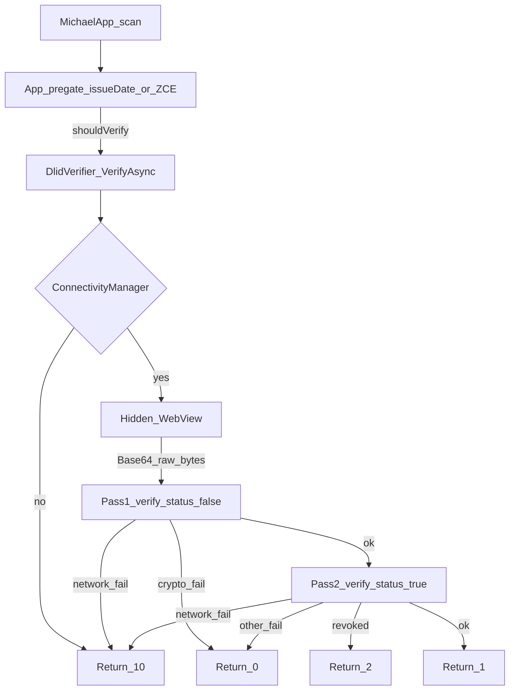

# iCA DL/ID Barcode Verifier — Completion Plan

## Current state vs sold scope

| Sold (Oct 21 scope) | In repo today |
|---------------------|---------------|
| Hidden WebView + `WebViewAssetLoader` | Node HTTP service ([integration/http-service.mjs](integration/http-service.mjs)) |
| `ca-verifier.bundle.js` + `verifyBarcode` | No esbuild / no browser bundle |
| `DlidVerifier.VerifyAsync` owning WebView | HTTP client sample ([DlidVerifierClient.cs](integration/xamarin-sample/DlidVerifierClient.cs)) |
| Standalone VS2022 Android demo | `#if false` paste sample only |
| Two-pass signature then revocation | Single `verifyWithCode()` with message mapping |

**Reuse from this SDK:** [`verify()`](lib/index.js), CA allowlists, UAT fixtures in tests, result-code semantics in [`lib/resultCodes.js`](lib/resultCodes.js). **Do not** ship Option A as the client integration path; keep the HTTP service only as a local SDK smoke tool if useful.

**Architecture to build:**



---

## Deliverable layout

Add a self-contained bridge package under `bridge/` (clean separation from the core SDK):

```
bridge/
  js/
    package.json          # esbuild + pin SDK + add missing @digitalbazaar/did-io
    src/verifyBarcode.js  # Base64 decode + two-pass + code mapping
    src/verifier.html
    scripts/build.mjs     # → dist/ca-verifier.bundle.js (IIFE, global CaVerifier)
    dist/                 # committed or CI-built artifact for Android assets
  android/
    Cadmv.DlidVerifier.Demo/   # full Xamarin.Android / VS2022 project
      Assets/verifier/         # html + bundle via WebViewAssetLoader
      DlidVerifier.cs
      VerifierJsBridge.cs
      DemoActivity.cs
  docs/
    INTEGRATION.md        # I/O spec, threading, timeout, update SDK, next state
    TEST_MATRIX.md        # cases + expected codes
```

Pin the SDK to the tested git commit when bundling (`file:../..` locally; document commit SHA for client installs).

---

## Task 1 — JS bundle and two-pass wrapper (2–3h)

1. Fix dependency gap: add `@digitalbazaar/did-io` (imported in [lib/index.js](lib/index.js) but missing from root [package.json](package.json)).
2. esbuild IIFE bundle exposing `globalThis.CaVerifier = { verifyBarcode }`.
3. Implement `verifyBarcode(base64Data, options)`:
   - Decode Base64 → `Uint8Array` (preserve AAMVA control bytes).
   - **Pass 1:** `verify({ data, mode: 'prod', verifyStatus: false })` — crypto only.
   - **Pass 2:** only if pass 1 valid → `verify({ ..., verifyStatus: true })`.
   - Map outcomes: `1` / `0` / `2` / `10` using the same fail-closed rules as the scope (network/fetch/timeout → `10`; revoked cause → `2`; everything else → `0`).
   - Default `mode: 'prod'`; allow `uat` for device testing via options.
4. Classify network failures from SDK error + `error.cause` (reuse patterns from [`messagesIndicateOffline`](lib/resultCodes.js)).
5. Build script + short regen instructions in `bridge/docs/INTEGRATION.md`.

Target bundle size ~410 KB as already proven in prior sandbox work.

---

## Task 2 — C# WebView host + standalone demo (4–6h)

Implement real Android hosting (not HTTP):

- **`DlidVerifier`**: owns one hidden `WebView`, `InitializeAsync()` at startup, `Task<int> VerifyAsync(string rawBarcode)`.
- Encode scanner string/bytes to Base64 in C# before calling JS (client: raw scanner format; Base64 only at the C#↔JS boundary).
- Load `https://appassets.androidplatform.net/.../verifier.html` via `WebViewAssetLoader` (secure context for `crypto.subtle`).
- Enable JS, DOM storage; add `[JavascriptInterface]` bridge that completes a `TaskCompletionSource<int>` by request id (avoid parsing `EvaluateJavascript` quoted strings).
- Marshal all WebView work to the UI thread; **queue** verifications (one at a time).
- **Timeout:** default **10 seconds** per call (scope default; change only if Michael confirms otherwise) → `0` on timeout.
- **Offline:** `ConnectivityManager` before JS → `10` without touching the WebView.
- **Demo app:** VS2022 Xamarin.Android project with paste/load fixture, Verify button, shows code + legend. Ship UAT valid/invalid samples as assets for first on-device proof that valid UAT → `1`.

Per-state hook: thin `VerifierStateConfig` (`StateId`, asset path, default mode) so NY/future states only swap bundle + wrapper later.

---

## Task 3 — Network and failure mapping (2–4h)

- Confirm on a real device/emulator that WebView origin can `fetch` DMV hosts (`credentials.dmv.ca.gov` / UAT).
- Map: device offline → `10`; DMV fetch failure mid-verify → `10`; allowlist / bad signature / malformed / empty → `0`; confirmed revocation → `2`.
- Cleartext: use HTTPS only to DMV; no need for cleartext traffic to DMV. Local assets are HTTPS via AssetLoader.
- Document that first on-device run must prove UAT valid sample → `1` (sandbox previously blocked DMV hosts).

---

## Task 4 — Test matrix (3–4h)

| Case | Expected |
|------|----------|
| Valid UAT sample (`mode=uat`) | `1` (status may be skipped or fail-closed if UAT lists 404 — document; use pass-1-only for UAT crypto proof if needed, then prod status path for revocation) |
| Invalid UAT signature | `0` |
| Malformed / empty | `0` |
| Wrong issuer / non-CA | `0` |
| Airplane mode | `10` before JS |
| Simulated DMV unreachable | `10` |
| Revoked (fixture/mock status) | `2` |
| Client `Cali-1.raw` / scanner raw (when provided) | `1` in `prod` with status |

Record results in `bridge/docs/TEST_MATRIX.md`. Reuse published UAT examples from existing Vitest fixtures where possible.

**Note on UAT status 404:** pass 2 with `verifyStatus: true` against known-broken UAT list URLs will return `10`, not `1`. Device acceptance for “valid → 1” should use either (a) pass-1-only demo toggle for UAT crypto, or (b) prod barcode + live prod status. Document both; default product path remains `prod` + status on.

---

## Task 5 — Plug into Michael’s app (blocked on access)

When he grants project access:

- Drop `DlidVerifier` + assets into iDetect at his scan call site.
- He already gates on issue date ≥ 2025-09-29 and/or signature present — do not re-implement that gate inside `VerifyAsync` (optional mirror of [`inspectBarcodeGate`](lib/verifyCoded.js) only if he asks).
- Switch default `mode` to `prod`.
- He wires the call; we support debug if the raw scanner string fails boundary encoding.

---

## Task 6 — Docs and handover (1–2h)

`bridge/docs/INTEGRATION.md` covering:

- Contract: Base64-of-raw-bytes in (internally), integer `1|0|2|10` out; 10s timeout; UI-thread marshaling; single-flight queue.
- How to regenerate the bundle and bump pinned SDK commit.
- How to add the next state (new bundle + `VerifierStateConfig`).
- Explicit scope limit: code `1` is barcode crypto + unrevoked, **not** physical card authenticity.
- Dependencies: AndroidX WebKit (`WebViewAssetLoader`), Internet permission, Chromium WebView.

---

## Out of scope (do not build)

- Validation logic beyond calling the CA DMV SDK.
- Physical-card authenticity.
- Shipping a Node process with the Android app.
- Jint / pure .NET JS engines.
- Changing Michael’s pre-gate or scan UI unless he shares call-site code for debugging.

---

## Definition of done

1. `bridge/js` builds `ca-verifier.bundle.js` reproducibly.
2. Demo APK builds in VS2022; hidden WebView initializes once.
3. On-device: offline → `10`; invalid → `0`; valid crypto path → `1`; revoked fixture → `2`.
4. Integration guide + test matrix written.
5. Ready to drop into Michael’s app when access is granted (Task 5).
